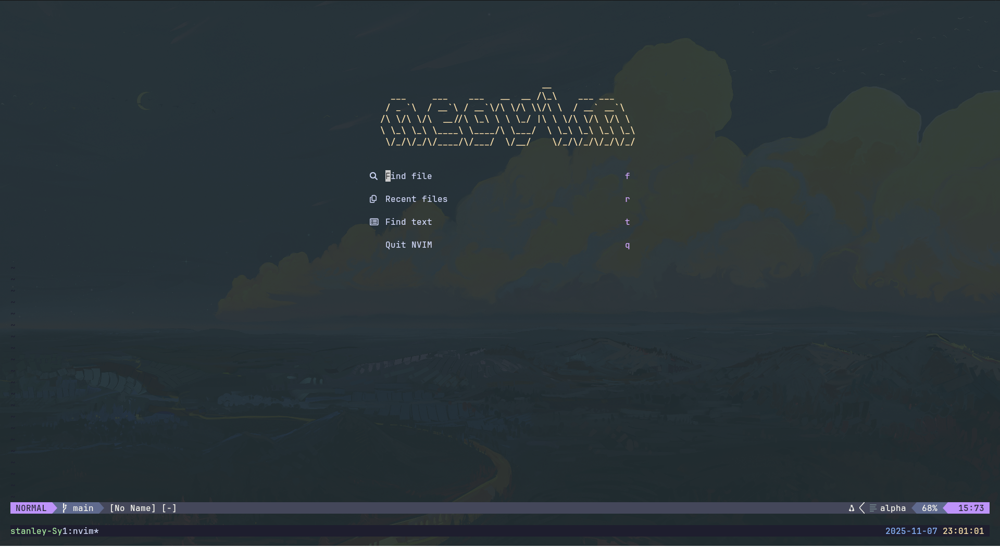

# Dotfiles

Reproducible Ubuntu development environment for Neovim, Kitty, and tmux. The
bootstrap installs pinned application and font versions, links the tracked
configuration into `$HOME`, and restores Neovim plugins and development tools.

<p align="center">
  
</p>

## Fresh Ubuntu Installation

```bash
sudo apt update && sudo apt install -y git
git clone https://github.com/stanleyavril123/dotfiles.git ~/.dotfiles
~/.dotfiles/install.sh
```

Restart Kitty after the installer completes. Then open Neovim and run
`:checkhealth` if you want to inspect the installed providers.

The installer is safe to run again. Existing files that are not already linked
to this repository are moved to timestamped backups before the links are made.

To install only the links without downloading packages or tools:

```bash
~/.dotfiles/install.sh --link-only
```

To install the editor and terminal setup without optional coding-agent CLIs:

```bash
~/.dotfiles/install.sh --no-agents
```

## Managed Setup

- Neovim 0.10.3 and its locked plugins
- Kitty 0.32.2 with transparency
- A shared theme selector for Kitty, tmux, and Neovim
- Kitty windows start maximized through the tracked `~/.local/bin/kitty` launcher
- tmux with `Ctrl-a`, Vim navigation, copy mode, and system clipboard support
- JetBrainsMono Nerd Font 3.3.0
- Starship 1.24.2 with a colored Nerd Font prompt and Git status
- Mason language servers and formatters
- Claude Code stable channel
- Codex prompts, chat history, and change review in Neovim
- Ubuntu command-line dependencies such as ripgrep, Node.js, Python, and build tools

Configuration is stored in the standard home-directory layout:

```text
~/.dotfiles/
├── .config/
│   ├── kitty/
│   ├── bash/
│   ├── nvim/
│   ├── themes/
│   └── starship.toml
├── bin/
├── .tmux.conf
└── install.sh
```

The installer creates these links:

```text
~/.config/nvim  -> ~/.dotfiles/.config/nvim
~/.config/kitty -> ~/.dotfiles/.config/kitty
~/.config/bash/prompt.bash -> ~/.dotfiles/.config/bash/prompt.bash
~/.config/starship.toml -> ~/.dotfiles/.config/starship.toml
~/.tmux.conf    -> ~/.dotfiles/.tmux.conf
~/.local/bin/kitty -> ~/.dotfiles/bin/kitty
~/.local/bin/theme -> ~/.dotfiles/bin/theme
```

## Themes

`theme` switches the color theme of Kitty, tmux, and Neovim together, including
sessions that are already open.

```bash
theme              # pick a theme, with live preview
theme list         # list the available themes
theme set nord     # apply a theme by name
theme next         # cycle to the next theme
```

The picker applies each theme as the selection moves and restores the previous
one if you leave with `Esc`. `Ctrl-Shift-p` opens it in a Kitty overlay,
`Ctrl-a T` in a tmux popup, and `<leader>ut` or `:Theme` inside Neovim.

23 themes are included:

| Theme | Variants |
| --- | --- |
| Catppuccin | Mocha, Latte |
| Tokyo Night | Night, Storm, Day |
| Gruvbox | Dark, Light |
| Rose Pine | Main, Dawn |
| Solarized | Dark, Light |
| GitHub | Dark, Light |
| Ayu | Dark, Mirage |
| Dracula | - |
| One Dark | - |
| Monokai | - |
| Nord | - |
| Nightfox | Nightfox, Carbonfox |
| Kanagawa | Wave |
| Everforest | Dark |

Each theme is a palette file in [.config/themes](.config/themes). Applying one
writes the generated color files that Kitty, tmux, and Neovim read:

```text
~/.config/kitty/theme.conf       included by kitty.conf, untracked
~/.local/state/theme/current     active theme name
~/.local/state/theme/tmux.conf   sourced by ~/.tmux.conf
~/.local/state/theme/nvim.lua    read and watched by Neovim
```

Kitty only resolves include paths relative to its own configuration directory,
which is why its generated file sits there and is listed in `.gitignore`.
Recoloring an open Kitty window uses its remote control socket, so windows that
were already running before this configuration was installed need one restart.

Add a theme by copying a palette file, either into `.config/themes` to track it
or into `~/.config/themes` to keep it on one machine. Neovim needs a matching
color scheme plugin in
[colorschemes.lua](.config/nvim/lua/plugins/colorschemes.lua); the palette
file's `nvim_plugin` and `nvim_colorscheme` values point at it.

### Readability

Published terminal palettes are drawn for looks rather than for contrast, and
many leave text uncomfortable to read, especially the light ones. Every palette
here is therefore checked against WCAG contrast ratios, measured against its own
background:

| Role | Minimum contrast |
| --- | --- |
| `foreground` | 7.0, AAA body text |
| colors 1-7, 9-15, `cursor`, selected text | 4.5, AA body text |
| `color8`, used for dim text | 3.0 |
| `color0` on a dark theme | 1.6, a shade of the background |

Colors that fell short were moved in lightness only, so hue and saturation stay
as published. Rerun the check after editing a palette:

```bash
~/.dotfiles/bin/theme-contrast         # report every palette
~/.dotfiles/bin/theme-contrast --fix   # raise whatever is below the floor
```

Neovim needs the same care, and it renders on Kitty's background because its
color schemes run transparent, so
[theme.lua](.config/nvim/lua/config/theme.lua) measures against that background
and lifts `Normal`, `Comment`, `LineNr`, `NonText`, and `Whitespace` when a color
scheme dims them too far. It also strips any background a color scheme paints
itself, which keeps Kitty's opacity working everywhere.

## Updating

Edit the files through their normal paths, commit from `~/.dotfiles`, and push:

```bash
cd ~/.dotfiles
git add .
git commit -m "chore: update development environment"
git push
```

On another computer:

```bash
cd ~/.dotfiles
git pull
./install.sh
```

That is the normal sync loop: make a change on one computer, commit and push
it, then pull and rerun the installer on the other. The symlinks mean edits made
through `~/.config/nvim`, `~/.config/kitty`, or `~/.tmux.conf` are edits to this
repository and are ready to commit.

## What Stays Machine-local

The installer adds one source line to `~/.bashrc` for the tracked prompt config.
SSH keys, GitHub tokens, and coding-agent credentials stay on each machine.
Sign in to the services you use after setup.

## Neovim Workflow

Leader is `Space`.

| Mapping | Action |
| --- | --- |
| `<C-p>` / `<leader>sf` | Find files |
| `<leader>sg` | Live grep project |
| `<leader>xx` | Workspace diagnostics |
| `<leader>xb` | Buffer diagnostics |
| `<S-h>` / `<S-l>` | Previous or next buffer |
| `<leader>bp` | Pick a visible buffer |
| `<leader>bd` | Close buffer |
| `<C-n>` | Toggle file explorer |
| `<leader>gg` | Open Neogit |
| `<leader>gd` | Open Diffview |
| `<leader>mp` | Toggle rendered Markdown preview |
| `<leader>ut` | Switch theme |

Use `:Mason`, `:ConformInfo`, `:OverseerRun`, and `:checkhealth` to inspect the
development tooling.

## Codex in Neovim

Install the [Codex CLI](https://developers.openai.com/codex/cli) separately and
make sure `codex` is on `PATH` when you start Neovim. Run `codex login` if you
need to sign in. The floating prompt uses `codex app-server` and shares the
CLI's sign-in and settings. This configuration was tested with Codex CLI 0.171.0
and Neovim 0.10.3.

Open a project file or select text and press `<leader>aa` (or run `:Codex`).
Neovim includes the file or selected text. `Enter` sends the prompt and puts
focus back on the code. `Esc` closes the prompt and `Ctrl-j` adds a line.
The prompt shows the chat name and short ID, or **New chat** before the first
message. Type `/help` for commands, including `/model`, `/status`, `/chat`,
`/new`, and `/rename`. Run the same commands from the editor with `:Codex`,
for example `:Codex model` or `:Codex rename Checkout cleanup`.
Codex runs at the file's Git root, or Neovim's working directory outside Git.
Neovim remembers the active chat and model choice for each project across
restarts.

A corner indicator shows what Codex is doing and how long it has been running.
When Codex shares a plan, the indicator shows how many steps are complete. It
switches to a result summary when the turn finishes, while focus stays in the
editor. Command and file approval requests appear in Neovim.

Save the file if you want its buffer to refresh as Codex writes to disk. If
both versions change, Neovim keeps your unsaved buffer and shows a message.
Codex replies render Markdown in the result summary, review, and transcript.
The transcript uses separate theme colors for **You** and **Codex**.

| Mapping | Action |
| --- | --- |
| `<leader>aa` | Open the Codex prompt for the current file or visual selection. |
| `<leader>ac` | Open the Codex command menu. Model and reasoning choices apply to subsequent turns in this project. |
| `<leader>at` | Read the active chat's prompts and answers. Press `o` for older turns or `r` to reply in that chat. |
| `<leader>ar` | Review the current or latest turn. `Enter` jumps to a hunk, `d` shows its diff, and `r` asks for a revision in the same chat. |
| `<leader>ah` | Find an earlier project chat or start a new one. The next prompt otherwise continues the active chat. |
| `<leader>ax` | Stop the current turn. Changes already written to disk remain available for review. |
| `<leader>gd` | Open Diffview for the full working-tree diff. |

For a separate terminal, use `Ctrl-a v` in tmux and start `codex` or `claude`
from the project root.

## tmux Workflow

`Ctrl-a` is the prefix. Use `Ctrl-a [` to enter Vim-style copy mode, `v` to
select, `y` or `Enter` to copy, and `Ctrl-a ]` to paste. Prefix followed by
`h`, `j`, `k`, or `l` changes panes. `Ctrl-a T` opens the theme picker.

## License

MIT - see [LICENSE](LICENSE).
